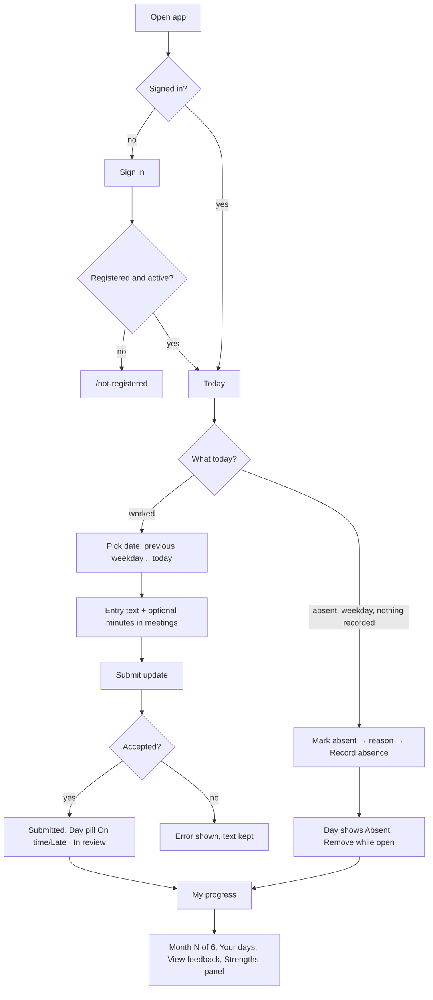
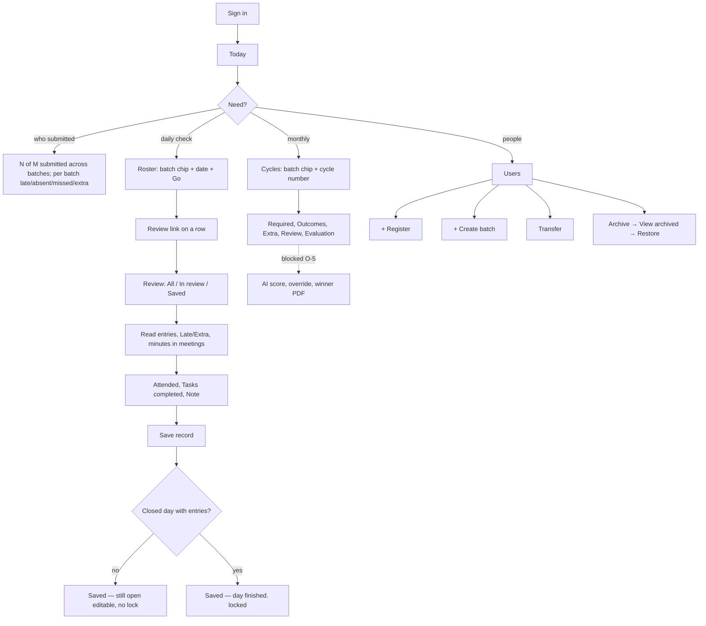

# Features, To-Do, and User Flows
---

## 1. Users and roles

| Role | Who | 
|---|---|
| **Mentor (Admin)** | Hearts Academy mentors. Every mentor is an Admin and sees every batch (FR-2, FR-4) | 
| **Student** | IRP interns, enrolled in one batch at a time | 

---

## 2. Current features (built)

### 2.1 Shared / platform

| Feature | FR / NFR |
|---|---|
| Azure-AD-shaped JWT auth. The API validates every token with `jose` against a JWKS | FR-1, NFR-14 |
| Role gating: a student who opens `/roster`, `/cycles`, `/students` or `/review` is redirected to `/`. The API enforces the same rule | FR-2, FR-30 |
| `/not-registered` page: "Your account is not registered … There is no self-registration — ask a mentor to add you, then sign in again." Its only control is "Sign out". The web app turns the API's 403 into a redirect to this page | FR-1, FR-5 |
| Settings → Appearance → Theme: "Light" / "Dark" / "Follow system" (the default). Stored in the `irp-theme` cookie and applied as `data-theme` on `<html>` | *(no FR, O-14)* |
| App frame: Bistec Hearts Academy brand mark, sidebar icons, Sign out in the sidebar | *(no FR, O-15)* |
| Bistec cerulean `--primary`, enforced by a WCAG AA token matrix (32 pairs per theme, light and dark) parsed from `globals.css` | design system |
| UTC storage; all deadlines and cycles evaluated in Asia/Colombo | NFR-12 |
| Grace window: a weekday stays submittable until the end of the next weekday, so Friday stays open until Monday 23:59 (O-10). Late = submitted after the day ended. Weekends are never late | FR-12–15 |
| **Notifications**, fire-and-forget. They fire on **entry submitted**, **absence marked**, and **report finished**. Removing an absence or a plain record save does not notify. **Channels:** a Teams webhook card with an "Open review" button, and SMTP email to every active mentor. Each channel turns itself off if its env var isn't set | FR-21 |
| OpenAPI 3.1 spec (lints clean under `recommended-strict`), generated types package and generated client SDK | NFR-7, NFR-8 |
| RFC 7807 Problem Details errors that carry a traceId; OpenTelemetry tracing | NFR-6 |
| `Dockerfile`, `compose.yaml`, `infra/main.bicep`, `ci.yml` (UTC / New_York / Kiritimati matrix plus Playwright) and `deploy.yml` all exist. **Never applied to Azure** | NFR-5 |

### 2.2 Student features

**Today (`/`)**

| Feature | FR |
|---|---|
| Greeting band: "Good morning/afternoon/evening", the date, and a journey bar ("Month 3 of 6", "3 to go" / "final month"),Motivational line | FR-29 *(refresh, ADR-0031/0032)* |
| Cycle ribbon of the student's own days ("10 October – 9 November", "21 required days in this cycle"). The counts row reads "N on time · N late · N absent · N missed", plus "+N extra" when there is any | FR-29, FR-33 |
| "Recent days": cards for the days still open, each showing its pill and entries. Open-day copy reads "You can still submit for {day} until {deadline}."; a closed day reads "Missed — the grace window closed on {date}." | FR-13, FR-14 |
| **Composer** ("Submit an update"): a date dropdown, an "Entry text" box (up to 4000 characters), "Minutes in meetings (optional)" (0–480), and a "Submit update" button | FR-10, FR-17 |
| The date dropdown offers every date from the **previous weekday through today**, weekends included: on Thursday, Thu and Wed; on Monday, Mon, Sun, Sat and Fri. No other date can be chosen | FR-15 |
| Multiple entries per day, rolled up into one daily report | FR-11 |
| On success: "Submitted.". The day's pill becomes "On time · In review" (or "Late · In review"), and the ribbon replays its fill animation (instant under reduced motion) | FR-13, FR-18 |
| On error, the typed text and minutes are kept | NFR-9 |
| Individual entries only show a "Late" or "Extra" pill. There is no per-entry "On time" | FR-13, FR-33 |
| **Mark absent**: shown only when the selected date is a weekday with nothing recorded. The student fills in "Why were you absent?" and clicks "Record absence", which confirms "Marked absent — {reason}". | FR-16 |
| **Remove absence**: a "Remove" button on that day's card, available while the day is open and not locked | FR-16 |
| Absence rules: an absent day can't take entries, and a day with entries can't be marked absent (409). Weekends can't be marked absent | FR-12, FR-16 |
| Mentor note behind a "View feedback" / "Hide feedback" chip that opens a "From your mentor" block | FR-19 |

**My progress (`/my-progress`)**

| Feature | FR |
|---|---|
| Header "Month N of 6 · {cycle dates}". The dates are the cycle of the batch the student is in today (ADR-0035), so a transfer moves them onto the new batch's calendar and numbering | FR-7, FR-29 |
| "Your days" history, newest first, stopping at today, with "This month" / "This week" chips | FR-29 |
| Each day shows an outcome pill (On time / Late / Absent / Missed / Open / Extra) plus "· In review" or "· Saved" (with a lock). Entries show times and "N minutes in meetings". Mentor notes sit behind "View feedback" | FR-17, FR-18, FR-29 |
| "Strengths and areas to develop" panel, which shows "No evaluation yet — your first summary appears after your month closes." until AI evaluation exists | FR-29 |
| No score, rank or other student's data anywhere. The `/me` endpoints take no student id | FR-30 |

### 2.3 Mentor features

**Today (`/`)**

| Feature | FR |
|---|---|
| Greeting band, plus a status line such as "1 of 8 submitted across 2 batches" | FR-28 |
| One block per batch, labelled "Batch 1 · Cycle 3 · Day 4 of 21" (on weekends: "… · the last required day, not today"). Each block has a ribbon, "N of M submitted", "N late", "N absent", "N missed" and "+N extra this cycle" | FR-28 (must-ship, SC-4), FR-33 |
| Collapsible "How to read this" key: each bar shows the worst outcome in the batch that day | ADR-0020 |

**Roster (`/roster`)**

| Feature | FR |
|---|---|
| Batch chips ("Batch 1" / "Batch 2") and a "Date" input with a "Go" button | FR-19, FR-28 |
| Columns: Student (name and email) · Status · Entries · Extra (cycle) · Absence reason · Recorded ("✓ recorded" / "— none") · Review (link) | FR-19, FR-33 |
| Archived students are not listed | FR-5 |

**Review (`/review/{studentId}`, reached from Roster)**

| Feature | FR |
|---|---|
| "Review — {name}". The filter chips are "All" (the default), "In review" and "Saved", above a summary line such as "4 in review · 0 saved · 4 days this cycle". A day counts as saved once the mentor has stored a record for it (or it is Evaluated), so a saved day stays in place on All | FR-18 |
| Days in the current cycle, newest first. Empty weekends are hidden | FR-12, FR-33 |
| Each day shows its outcome pill, the entries with times, any Late/Extra flags, and "N minutes in meetings" | FR-17 |
| Per day: "Attended" ☐, "Tasks completed" ☐, "Note (optional)" and a "Save record" button. The form is prefilled from the stored record. Helper text: "Saving replaces that day's whole record — attendance, tasks and note together." | FR-19 |
| A day the student can still submit to is saved without being finished or locked ("Saved — the day is still open to the student, so you can edit this."). It shows "· Saved" and stays editable | FR-20 |
| A closed day that **has entries** is saved and also finished and locked ("Saved — day finished.") | FR-18, FR-20 |
| A mentor can record attendance on a weekday with no submission (not on future days) | FR-19 |
| Born *In Review*; no "start review" step; no reject anywhere (ADR-0028/0029) | FR-18 |

**Cycles (`/cycles`)**

| Feature | FR |
|---|---|
| Batch chips. The cycle picker shows "1"–"6". Started cycles are links; the rest are dimmed and can't be clicked | FR-9 |
| Heading such as "Cycle 3 · Saturday 10 October – Monday 9 November". Cycle dates come from the batch's own start and end dates (cycle 1 starts on the batch start; the last cycle is cut at the batch end), not a fixed 10th-to-9th | FR-9, ADR-0035 |
| Columns: Student · Required · Outcomes ("N on time · N late · N absent · N missed") · Extra · Review ("N evaluated · N to review") · Evaluation ("Awaiting evaluation") | FR-28 |

**Users (`/students`)**

| Feature | FR |
|---|---|
| "+ Register" and "+ Create batch" buttons, each opening a modal dialog | FR-3, FR-6 |
| View chips: "Students" (the default), "Mentors" and "View archived". There is no "All" view and no Role column | FR-3, FR-4 *(label: O-21)* |
| Students view: Name · Email · Batch · Actions ("Transfer", "Archive"). Mentors view: Name · Email · Actions. The signed-in mentor's own row is marked "You" and has no Archive button | FR-3, FR-5 |
| **Register** fields, in order: Role (Student/Mentor), Email, Display name, External id ("Their Microsoft Entra object ID … Not their email."), then Batch and Start date (students only). The API rejects a student without an enrolment, or a mentor with one. Confirms "Registered." | FR-3 |
| **Create batch**: Batch name, Start date, End date. The API rejects start ≥ end. Confirms "Batch created." | FR-6 |
| **Transfer**: "New batch" and "Effective date". History follows the student (ADR-0017). Confirms "Transferred." | FR-8 |
| **Archive**: opens a confirmation dialog ("Archive {name}") and only **Confirm archive** archives. The user disappears from Roster, Cycles and dashboards; history is kept; self-archive is refused | FR-5, NFR-11 |
| **Archived view** (`?view=archived`): name, email and role, with a "Restore" button on each row | FR-5 |

---

## 3. To-do features

### 3.1 Blocked

| Feature | FR | Blocked on |
|---|---|---|
| **AI monthly evaluation**: a summary of the month and a rubric score (20/25/25/10/20) as the performance index | FR-22, FR-23, FR-25, FR-26 | **O-5**, the AI provider and data-processing approval (needs an ADR and a leadership decision). Also **O-6**, the rubric wording. Prisma already has `Cycle`, `Evaluation`, `Override` and `Award` tables, but no code uses them and no endpoint exists |
| **Mentor override** of the score (new score, original score, reason) | FR-24 | FR-23 |
| **Strengths-and-weaknesses** summary content (the panel exists; `strengthsAndWeaknesses` is hard-coded `null`) | FR-29 | FR-22 |
| AI determinism (±2 points, model version persisted) | NFR-15 | FR-23 |
| Real Microsoft sign-in, `infra/entra.bicep`, removing the dev bypass | FR-1 | Governance sign-off for BISTEC's live tenant |

### 3.2 Not started

| Feature | FR / NFR | Notes |
|---|---|---|
| **Monthly winner per batch** with a deterministic tie-break | FR-31 | Assumed order (O-3): score → compliance → earliest average submission time |
| **Downloadable winner PDF** with an AI justification | FR-32 | Assumed download-only (O-2) |
| **First real deploy** (runbook §1 bootstrap, then Bicep applied from CI) | NFR-5, NFR-6, NFR-14 | Templates and workflow are written but have never been applied |
| **k6 load tests**: `tests/load/` does not exist | NFR-1–4 | Need a deployed URL. NFR-3 also needs real Entra |
| Retro (Plan 11) | — | After the load test |

### 3.3 Planned UI work (no FR)

| Item | Status |
|---|---|
| **Cycle calendar**: a month grid replacing the ribbon on both Today pages (O-17) | Plan written (`docs/superpowers/plans/2026-09-29-cycle-calendar.md`), **not built**. `CycleRibbon` is still the live component |
| Student surface refresh (`feat/ui-ux-improvements`) and this mentor branch stacked on it | PRs not yet opened |

### 3.4 Gaps and defects found while verifying

| Item | Evidence |
|---|---|
| **Stale copy after the Users rename**: "Create one from the Students page." and "Enrol students from the Students page." | `mentor-today.tsx:57`, `roster/page.tsx:60,135`, `cycles/page.tsx:63,163` |
| Seed/test data: a user "S" (`m-1@dev.local`) with no batch appears in the Students view. It looks like leftover test data, not seed data | seen in the running app |
| Weekend Extra is not batch-clipped. A transferred student's weekend entry can count in both batches' Extra. It never enters the settled-day counts | `dashboard-service.ts:161-169` |
| O-16: the theme can show stale after pressing browser Back; it fixes itself on reload | `theme-control.tsx:37-49` |
| The day history uses `div`s and section labels, not headings or lists, so screen readers can't navigate it by heading | `my-progress/page.tsx` |
| The submit animation replays the whole ribbon, not just the one day's mark (a known deviation, noted in comments) | `cycle-ribbon.tsx:219-225` |

### 3.5 Deferred to v2

Quarterly evaluation; automated emailing of the monthly report.

### 3.6 Open points awaiting stakeholder sign-off (non-blocking)

| Point | Topic |
|---|---|
| O-2 | Email vs download for the report |
| O-3 | Winner tie-break |
| O-4 | Leadership access |
| O-7 | Absence penalty |
| O-12 | Next.js 16 instead of 15 |
| O-14, O-15, O-17, O-21 | UI changes with no FR |
| O-19, O-20 | FR-18 / FR-20 wording |

Full list in `docs/interview-and-prd.md` §5.

---

## 4. User flows

### 4.1 Student

**Daily submission (main flow, NFR-9)**
1. Sign in to land on **Today**. Read the greeting band, the motivation line, the ribbon, the counts and the "N of M days submitted" chip.
2. Under **Submit an update**, pick the date. Only dates from the previous weekday through today are offered (FR-15).
3. Type in "What did you work on?" and optionally fill in **Minutes in meetings**.
4. Click **Submit update**. "Submitted." appears and the day's card in **Recent days** shows "On time · In review" (or "Late · In review").
5. Submit again to add more entries to the same day; they roll up into one report (FR-11).
6. Mentors get a Teams card and an email (FR-21).

*Walked through on 2026-10-15: the streak went from 3 to 4, the counts from 3 to 4 on time, and the entry showed on My progress with "30 minutes in meetings".*

**Mark or remove an absence (FR-16)**
1. Select a weekday that has nothing recorded, then click **Mark absent**.
2. Enter "Why were you absent?" and click **Record absence**. The confirmation reads "Marked absent — {reason}".
3. To undo, click **Remove** on that day's card while the day is still open and not locked.
4. **Mark absent** doesn't appear for a day that already has entries, or for weekends.

**Weekend work (FR-33)**
1. On Saturday or Sunday, submit as normal. The entry gets an "Extra" pill and is never missed or late.

**Check progress (FR-29)**
1. Open **My progress**. It shows "Month N of 6 · {cycle dates}".
2. Switch between **This month** and **This week**, read each day's pill, and open **View feedback** to see mentor notes.
3. **Strengths and areas to develop** shows the "No evaluation yet…" placeholder for now.

**Edge cases**
- Days outside the window, and locked days, aren't in the dropdown, and the API rejects them anyway (FR-14, FR-20).
- Opening a mentor URL redirects to `/` (checked live with `/cycles`).

### 4.2 Mentor

**Daily check (FR-28)**
1. Sign in to land on **Today**. The status line reads, for example, "1 of 8 submitted across 2 batches".
2. Each batch block shows "Batch N · Cycle N · Day N of 21", a ribbon, "N of M submitted", late, absent, missed and "+N extra this cycle".
3. Open **How to read this** for the ribbon key.

**Review a student's days (FR-18–20)**
1. Open **Roster**, pick a batch chip and optionally a date, then click **Go**.
2. Click **Review** in a student's row (rows themselves aren't clickable, and there's no Review sidebar item).
3. The page opens on the **All** filter for the current cycle (chips: All · In review · Saved). For each day, read the entries, flags and minutes in meetings.
4. Tick **Attended** and/or **Tasks completed**, optionally fill in **Note (optional)**, then click **Save record**.
   - If the day is still open: "Saved — the day is still open to the student, so you can edit this." The day shows "· Saved" (no lock), counts as saved, stays in place on the page, and can be edited; Roster's Recorded column shows "✓ recorded". It locks only when you save again after the day closes.
   - If the day is closed and has entries: "Saved — day finished." It's locked for the student and moves under **Saved**.
   - If the day was missed or absent (no entries): saving the record marks it **Saved** (there is no report to lock, so it stays editable).
5. Use **Saved** or **All** to see the other days.

*Walked through on 2026-10-15 on an open day: it saved, stayed In review, and Roster showed "✓ recorded".*

**Monthly view (FR-9, FR-28)**
1. Open **Cycles**, pick a batch chip, then a cycle number. Only cycles that have started can be clicked.
2. Read each student's Required, Outcomes, Extra, Compliance and Review progress. The Evaluation column shows "Awaiting evaluation".
3. *Not built yet (blocked on O-5):* AI score and summary, overriding with a reason, the batch winner and the PDF.

**Manage users and batches (FR-3/5/6/8)**
1. Open **Users** and switch between **Students** and **Mentors**.
2. **+ Register**: choose Role, then fill in Email, Display name and External id (the Entra object ID), plus Batch and Start date for a student. Click **Register**.
3. **+ Create batch**: fill in Batch name, Start date and End date, then click **Create batch**.
4. **Transfer** on a student's row: choose New batch and Effective date.
5. **Archive** on a row opens a confirmation dialog; click **Confirm archive** to proceed. To undo it, open **View archived** and click **Restore**.

**Settings**
1. Under **Appearance**, pick **Light**, **Dark** or **Follow system**.

### 4.3 Unregistered or archived user

1. They sign in with a valid tenant account.
2. The API returns 403 and the web app redirects to **`/not-registered`**: "Your account is not registered. You signed in successfully, but no one has registered you on the programme yet…" *(checked live)*
3. Their only option is **Sign out**. A mentor has to register them, or restore an archived account, from **Users**.

### 4.4 Leadership (future, read-only)

1. No login in v1 (O-4).
2. *Not built:* they would receive the monthly winner PDF downloaded by a mentor (FR-32, O-2) and read it without a briefing (SC-3).
